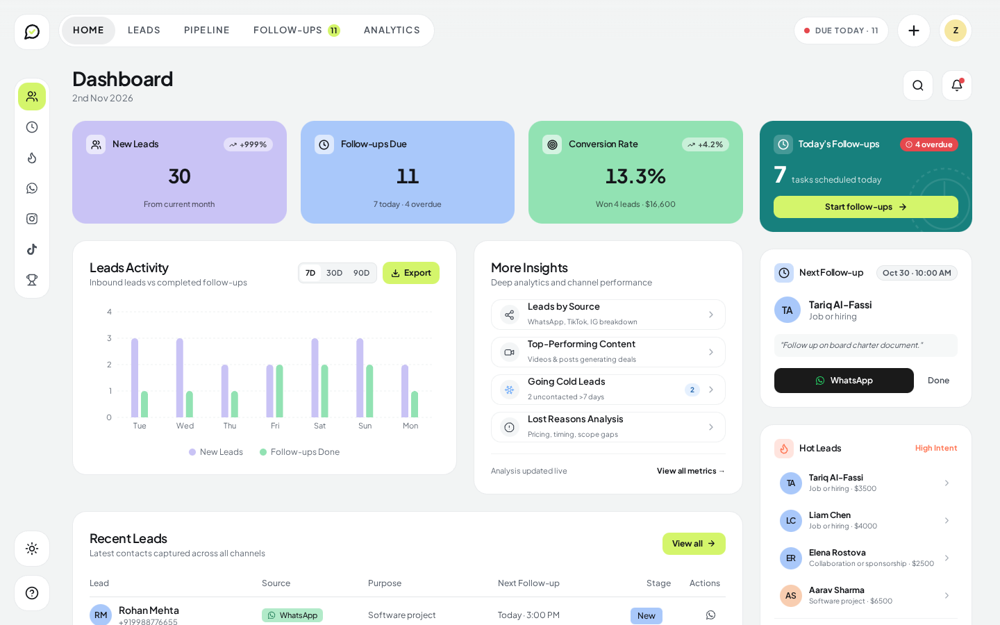
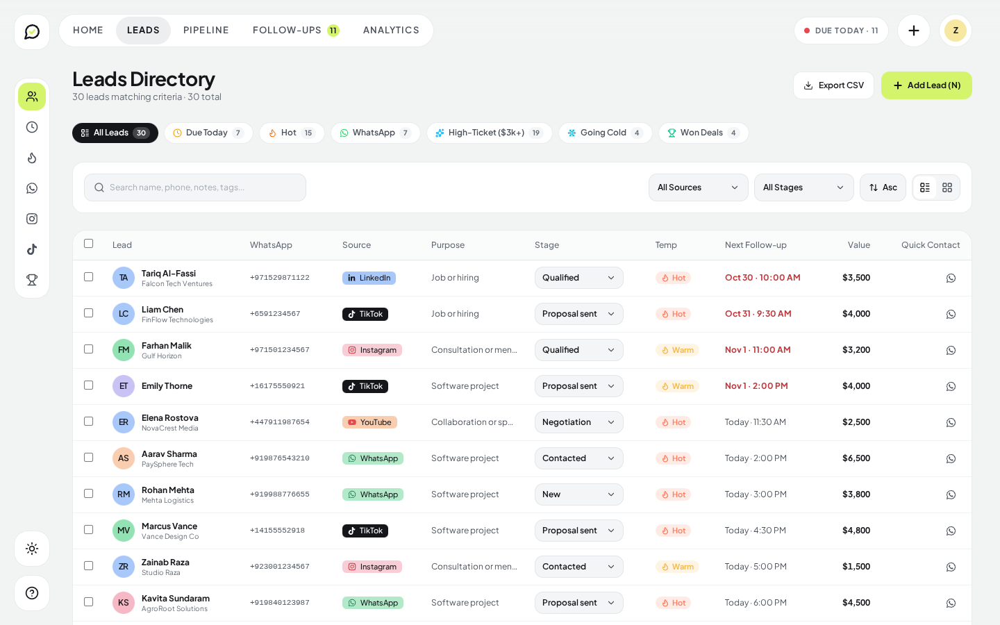
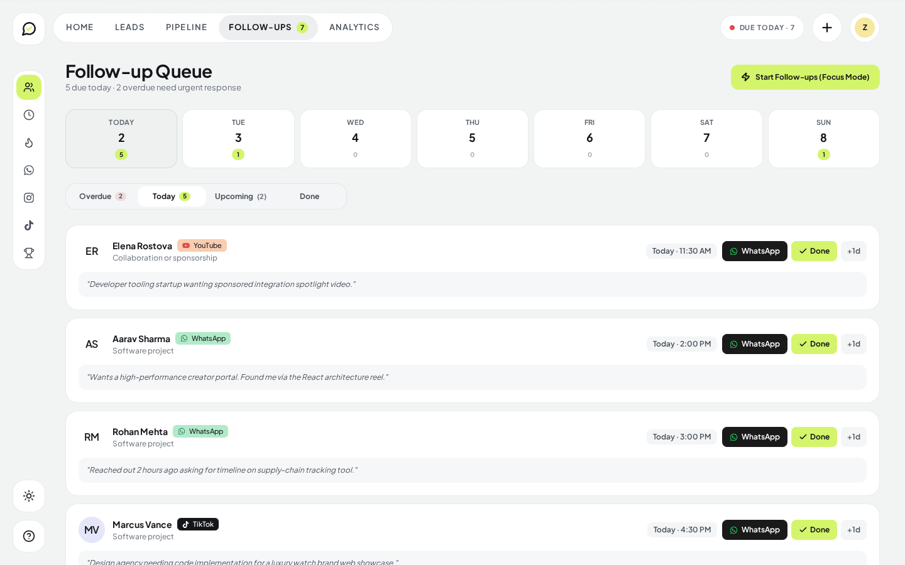
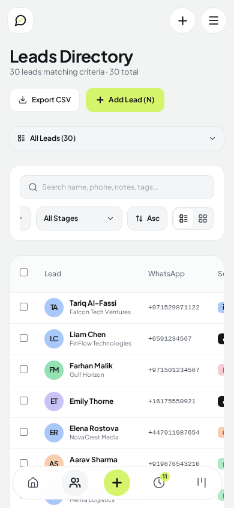
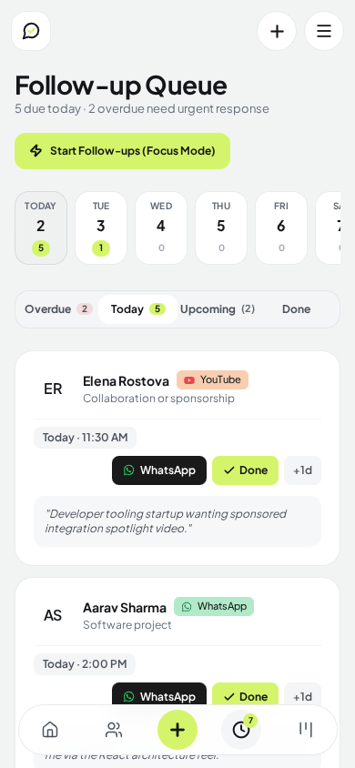
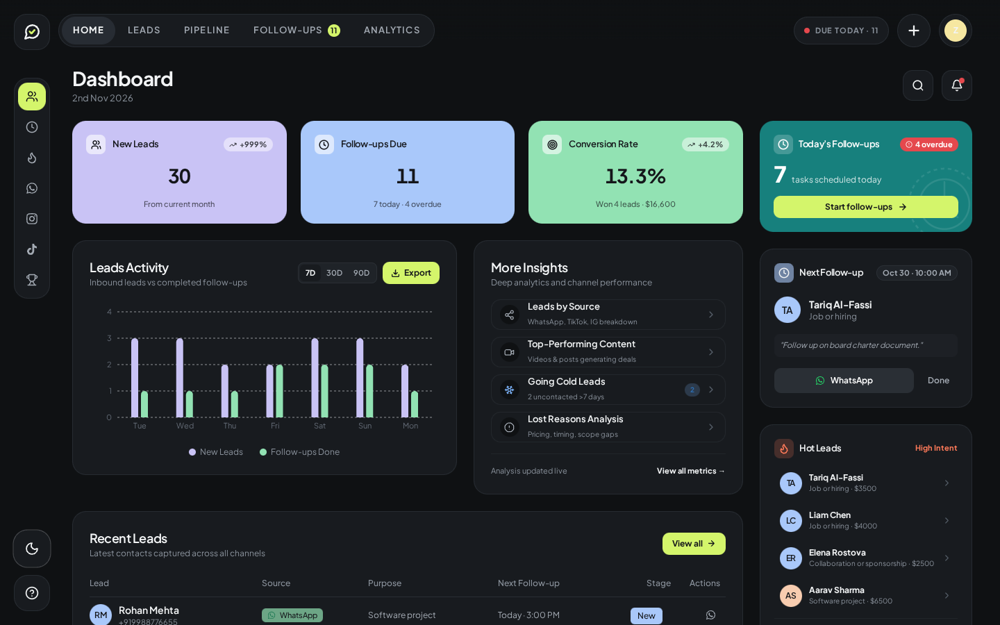
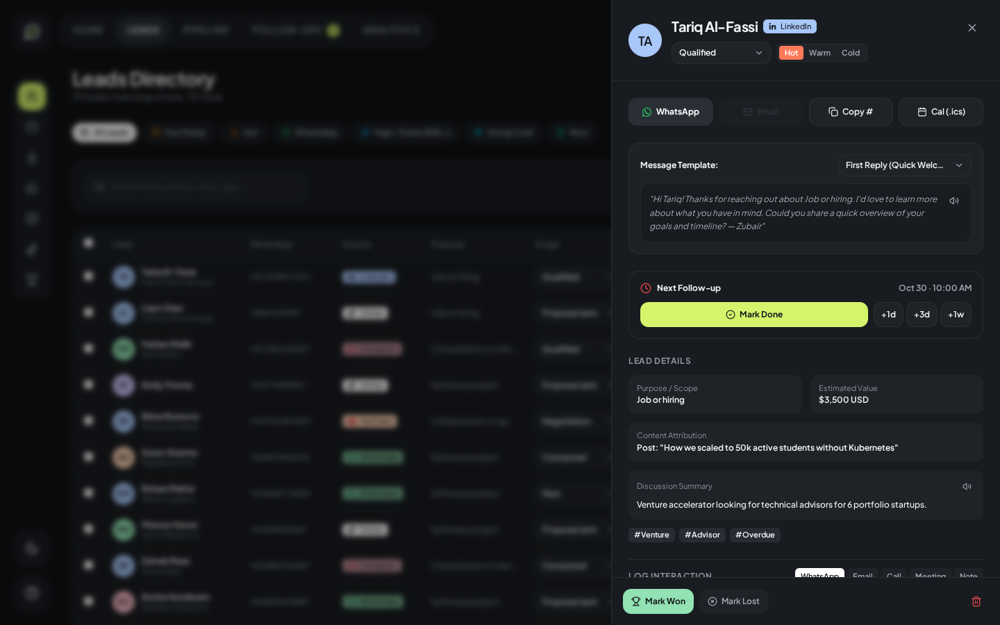

# LeadDesk — Personal Lead Management for Solo Creators

A high-performance personal lead-management dashboard hand-designed with Apple-level smoothness for software engineers and creators getting inbound leads from **WhatsApp**, **TikTok**, **Instagram**, **YouTube**, and **LinkedIn**.

---

## Visual Showcase

### 1. Main Dashboard

*Pastel KPI cards, live leads activity bar chart, top-performing content attribution, today's urgent follow-ups, and recent inbound leads table.*

### 2. Leads Directory & Preset Filters

*Non-scrolling wrapped filter presets with live real-time counts, multi-column search, channel filter, stage dropdown, and bulk management.*

### 3. Follow-up Queue & 7-Day Calendar Strip

*Responsive 7-day calendar strip, Overdue/Today/Upcoming tabs, inline cadence scheduler, and 1-tap direct WhatsApp outreach.*

### 4. Mobile Ergonomics & Responsive Layout
<p align="center">
  
  &nbsp;&nbsp;&nbsp;&nbsp;
  
</p>
*Designed for one-handed operation on smartphones: native dropdown filter presets, wrapped action toolbar, and zero horizontal scroll clipping.*

### 5. Dark Mode Experience
<p align="center">
  
  &nbsp;&nbsp;
  
</p>
*High-contrast dark mode featuring custom ink tones (`#14161A`) and lime accent highlights (`#D4F56B`).*

---

## Key Features

- **< 10-Second Lead Capture**: Rapid modal with voice dictation (speech-to-text), country code phone parsing (`libphonenumber-js`), and smart duplicate detection.
- **Follow-up Never Missed**: Overdue and Due Today follow-ups are pinned to the header and top of the queue. Mark done inline and schedule a next cadence (`+2d`, `+1w`) in a single click.
- **Content & Channel Attribution**: Automatically tracks which TikTok video, Instagram reel, or YouTube tutorial converted into high-ticket paid software deals.
- **Focus Mode**: Distraction-free, single-lead carousel with 1-click WhatsApp messaging and speech synthesis read-aloud.
- **Keyboard-First Shortcuts**: `⌘K` command palette, `N` for new lead, `/` for search, and `G + L / P / F / A` chord navigation.

---

## Architecture & Technology Stack

### Modular Full-Stack Design

```text
/
├── api/
│   └── index.ts                    # Vercel Serverless Function entry point
├── server/
│   ├── server.ts                   # Root Express server on port 3000
│   ├── app.ts                      # Express app configuration & middleware
│   ├── config/
│   │   └── db.ts                   # Mongoose connection manager + mock fallback
│   ├── data/
│   │   └── mockData.ts             # Unified single source of truth
│   ├── middleware/
│   │   ├── errorHandler.ts         # Centralized error handler
│   │   └── validate.ts             # Request validation
│   └── modules/
│       ├── leads/                  # Model, Controller, Routes, Types
│       ├── templates/              # Model, Controller, Routes, Types
│       ├── settings/               # Model, Controller, Routes, Types
│       └── analytics/              # Controller, Routes, Types
├── src/
│   ├── api/                        # Typed client layer with resilient local store fallback
│   ├── components/                 # React UI components (Shell, Leads, Pipeline, Followups)
│   ├── utils/                      # Analytics, formatting, date math, and phone parser
│   └── types/                      # Frontend shared interfaces
└── vercel.json                     # Serverless rewrite configuration
```

### Resilient Dual-Mode Data Layer
1. **Local & Static Mode (Zero-Config Default)**:
   - If `MONGODB_URI` is not set or when deployed as a static client, LeadDesk runs on an automated in-memory / `localStorage` store initialized from `server/data/mockData.ts`.
   - **Zero 404 Errors**: If the backend is unavailable or running on a static host, the client API automatically falls back to local persistence so creating, updating, and filtering leads always succeeds.
2. **MongoDB / Mongoose Mode**:
   - Provide `MONGODB_URI` in `.env` to automatically connect to MongoDB.
   - Collections are automatically indexed and seeded on initial run.

---

## Getting Started

### Prerequisites
- Node.js 18+ or Node.js 20+
- npm, yarn, or pnpm

### Installation

1. Clone the repository and install dependencies:
```bash
npm install
```

2. Copy the environment template:
```bash
cp .env.example .env
```

3. (Optional) Configure MongoDB in `.env`:
```env
MONGODB_URI="mongodb+srv://<username>:<password>@cluster.mongodb.net/leaddesk?retryWrites=true&w=majority"
```
*(Leave blank to use the built-in mock store)*

4. Start the development server:
```bash
npm run dev
```

Open [http://localhost:3000](http://localhost:3000) in your browser.

---

## Testing & Quality Assurance

Run the test suite (18 unit and backend tests):
```bash
node --import tsx --test src/utils/*.test.ts server/server.test.ts
```

Run TypeScript compilation check:
```bash
npm run lint
```

Build for production:
```bash
npm run build
```

---

## Deployment

### Deploying to Vercel
LeadDesk includes `vercel.json` and `/api/index.ts` out of the box:
1. Connect your repository to Vercel.
2. In Project Settings > Environment Variables, add `MONGODB_URI` (optional).
3. Deploy! Vercel will build the frontend and serve `/api/*` through serverless functions.
*(Note: Even on static deployments where serverless functions are not enabled, the client's built-in fallback store prevents 404 errors).*

### Deploying to Node.js / Docker / VPS
```bash
npm run build
npm start
```
Starts the full-stack server on `http://0.0.0.0:3000` with Express handling both API endpoints and static SPA routing.
